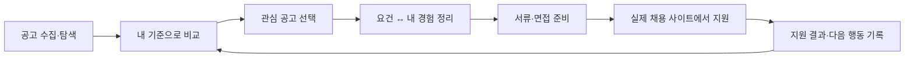

# 채용보드 제품 기획

## 1. 해결하려는 문제

채용공고를 여러 사이트에서 찾고, 회사 정보를 비교하고, 내 경험을 공고 요건에 맞춰 정리하고, 지원과 면접을 준비하는 과정이 흩어져 있습니다. 공고를 많이 모아도 **어느 공고에 왜 지원할지**, **무엇을 보완할지**, **다음에 무엇을 할지**로 이어지지 않으면 활용하기 어렵습니다.

이 보드는 로봇·AI 분야 구직자가 공고 탐색부터 지원 기록까지 같은 맥락에서 판단하고 준비하도록 만든 개인용 채용 워크스페이스입니다. 공고·회사·면접 후기 같은 공용 정보와 내 경험·서류·지원 기록 같은 계정별 정보를 연결합니다.

화면 흐름은 [가상 데이터 체험 화면](interactive-demo.html)에서 직접 조작해 볼 수 있습니다.

## 2. 핵심 사용 흐름

## 3. 주요 기능과 만든 이유

| 기능·메뉴 | 겪는 문제 | 보드에서 하는 일 | 사용자가 얻는 결과 |
|---|---|---|---|
| 공고 탐색·추천 (`공고`) | 사이트마다 검색 기준이 달라 공고를 놓치거나 관련성이 낮은 공고를 오래 살펴봄 | 국내·해외 후보를 한곳에서 검색·필터링하고, 내 기준을 바탕으로 적합도를 표시하며 관심·보류·숨김을 기록 | 검토할 공고를 좁히고 판단 근거를 남김 |
| 내 주변 회사 (`공고`) | 관심 회사와 관심 공고가 있는 회사를 따로 찾기 어려움 | 두 유형을 별도로 또는 함께 필터링해 지도와 목록에서 확인 | 위치와 관심도를 함께 고려 |
| 회사 정보·비교·면접 후기 (`회사`) | 공고 제목만으로 회사와 전형을 판단하기 어려움 | 여러 회사의 정보와 비교 지표, 수집된 면접 후기를 살펴봄 | 지원 우선순위와 준비 질문을 정함 |
| 내 정보·내 기준 (`나`) | 경력·기술·희망 조건이 흩어져 공고마다 같은 내용을 다시 판단함 | 경험과 기술을 정리하고 원하는 직무·조건 및 비교 기준을 입력 | 공고 비교와 준비에 쓸 개인 기준 확보 |
| 나 알아가기·직무 이해 (`나`) | 어떤 직무가 맞는지, 실제 업무가 무엇인지 모호함 | 경험·강점·선호를 기록하고 관심 직무의 업무와 기술을 학습 | 직무 선택에 쓰는 근거를 쌓음 |
| 공고별 준비 (`매니저`) | 공고의 필수·우대 요건과 내 경험 사이의 차이가 막연함 | 요구사항별로 경험·근거·보완 여부를 적고 서류·면접·프로젝트·할 일로 연결 | 해당 공고에 대한 준비 계획 |
| 서류·지원서 입력 (`준비`) | 공고마다 서류와 입력 항목을 반복 작성함 | 기본 이력서·포트폴리오·지원서 정보를 정리하고 관심 공고별 준비 자료를 관리 | 재사용 가능한 자료와 공고별 수정 지점 |
| 모의면접·AI 모의면접 (`준비`) | 질문을 알아도 제한 시간 안에 답하는 연습이 부족함 | 회사별 질문, 답변 타이머, 음성 읽기·입력, AI 평가 기능을 사용 | 답변 기록과 보완할 내용 |
| 지원 현황·오늘 할 일 (`지원`, `홈`) | 마감, 후속 연락, 준비 작업을 잊기 쉬움 | 지원 단계·날짜·메모와 반복 일정·제안된 할 일을 기록 | 다음 행동을 놓치지 않음 |
| 수집 설정·설정/백업 (`내 설정`) | 데이터 수집과 개인 기록의 상태를 파악하기 어려움 | 수집 설정, AI 연결, 백업과 연결 상태를 확인 | 운영 상태와 데이터 관리 경로 |

## 4. 제품 원칙

1. **출처와 원문을 남긴다.** 공고 요약이나 AI가 정리한 값은 원문 확인을 대신하지 않는다.
2. **판단과 기록을 분리한다.** 적합도와 추천은 참고값이며 관심·보류·지원 결정은 사용자가 한다.
3. **개인 기록을 계정별로 분리한다.** 공용 공고와 개인 정보·서류·지원 기록의 접근 범위를 구분한다.
4. **다음 행동으로 연결한다.** 분석 화면에서 끝나지 않고 서류·면접·할 일·지원 현황으로 이어진다.
5. **자동화의 한계를 표시한다.** 이미지 공고 읽기, AI 판정, 외부 사이트 수집은 누락과 오인식 가능성을 전제로 검증한다.

## 5. 현재 상태와 검증할 부분

- 현재 보드에는 위 메뉴와 기록 흐름이 구현되어 있습니다. 다만 실제 외부 사이트 수집, 실제 AI 키 사용, 브라우저 음성 인식은 환경별로 확인이 필요합니다. 세부 상태는 [README의 기능 표](../README.md#7-지금-되는-것--아직-안-되는-것)를 기준으로 봅니다.
- 이미지 공고는 **원본 저장 → 모든 글자 전사 → 사용자 정답과 비교 → 항목 분류**를 각각 검증해야 합니다. OCR 정확도와 필수·우대 분류 정확도는 다른 지표입니다. 실험 설계는 [OCR_LAB.md](OCR_LAB.md)에 있습니다.
- 실제 사람처럼 보이는 여러 면접관, 다른 지원자의 발화, 1:2·2:3 다인 면접은 **추후 과제**입니다. 현재 AI 모의면접과 구분하며, 구현 시 자료 근거·발화 순서·음성 인식 수정·질문 출처·평가 기준을 검증해야 합니다.

## 6. 성공을 판단하는 기준

| 목표 | 확인 방법 |
|---|---|
| 관련 공고를 놓치지 않고 찾기 | 관심 직무·회사 기준으로 수집된 공고의 누락 사례를 표본 점검 |
| 공고를 빠르게 판단하기 | 관심·보류·숨김을 결정할 때 원문, 요건, 회사 정보를 몇 단계 안에 확인하는지 관찰 |
| 공고별 준비의 실효성 | 필수·우대 요건마다 내 근거 또는 보완 행동이 기록되는 비율 확인 |
| 지원 과정 추적 | 관심 공고가 준비·지원 단계로 이동하고 결과 날짜가 남는지 확인 |
| 이미지 읽기 신뢰성 | 사용자 정답 전사본과 OCR 결과를 문자 단위로 비교하고 누락 위치 기록 |

이 수치는 제품 목표를 측정하기 위한 **평가 기준**이며, 현재 성능을 달성했다고 주장하는 값은 아닙니다.
