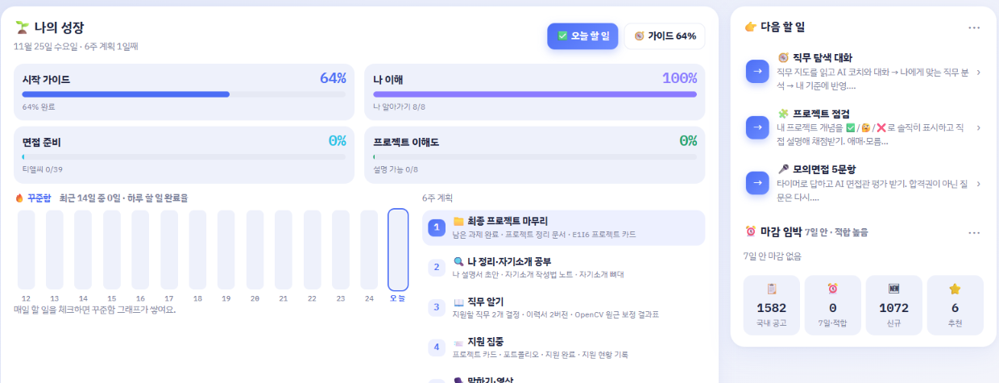

# 01 / 08 · 한눈에 보는 준비

**메뉴:** 홈 › 대시보드

> 진행률과 이번 주 계획, 다음 할 일, 마감 현황을 한 화면에서 확인합니다.

| 관점 | 설명 |
|---|---|
| 왜 필요한가 | 공고 탐색, 자기 이해, 서류, 면접 준비가 흩어지면 다음 행동을 놓치기 쉽습니다. |
| 어떻게 쓰나 | 진행률과 이번 주 계획, 다음 할 일, 마감 현황을 한 화면에서 확인합니다. |
| 남는 것 | 우선할 작업을 고르고 오늘 할 일로 이어갑니다. |

[← README](../../README.md) · [다음 화면 →](02-self.md)

> 화면 속 공고 수·날짜·진행률은 촬영 시점의 예시입니다.
