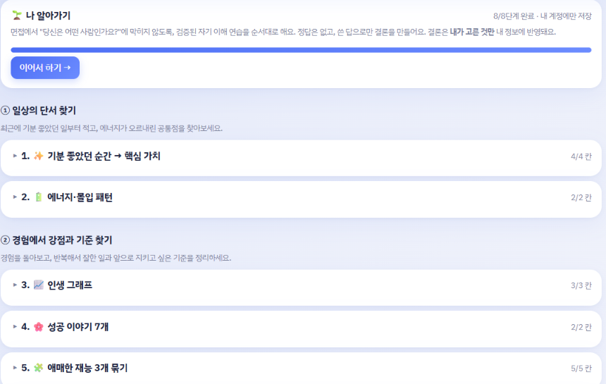

# 02 / 08 · 나를 기준으로 만들기

**메뉴:** 나 › 나 알아가기 · 내 정보 · 내 기준

> 좋았던 경험과 강점·가치관을 적고, 내 정보와 내 기준에서 경력·기술·희망 조건을 채웁니다.

| 관점 | 설명 |
|---|---|
| 왜 필요한가 | 가진 기술과 원하는 조건이 정리되지 않으면 공고마다 같은 고민을 반복합니다. |
| 어떻게 쓰나 | 좋았던 경험과 강점·가치관을 적고, 내 정보와 내 기준에서 경력·기술·희망 조건을 채웁니다. |
| 남는 것 | 공고 추천과 준비에 사용할 개인 기준이 생깁니다. |

[← 이전 화면](01-dashboard.md) · [다음 화면 →](03-jobs.md)

> 화면 속 공고 수·날짜·진행률은 촬영 시점의 예시입니다.
