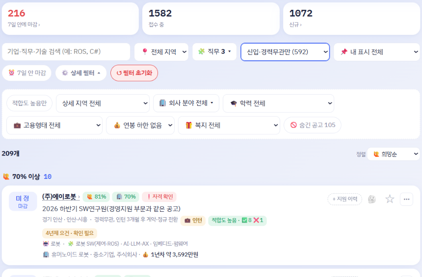

# 03 / 08 · 공고를 빠르게 좁히기

**메뉴:** 공고 › 국내 공고

> 직무·경력·지역·회사·적합도 등으로 필터링하고 원문과 표시 상태를 확인합니다.

| 관점 | 설명 |
|---|---|
| 왜 필요한가 | 채용 사이트를 오가며 비슷한 공고와 이미 본 공고를 반복해서 확인하게 됩니다. |
| 어떻게 쓰나 | 직무·경력·지역·회사·적합도 등으로 필터링하고 원문과 표시 상태를 확인합니다. |
| 남는 것 | 검토할 후보와 판단 이유를 남깁니다. |

[← 이전 화면](02-self.md) · [다음 화면 →](04-compare.md)

> 화면 속 공고 수·날짜·진행률은 촬영 시점의 예시입니다.
