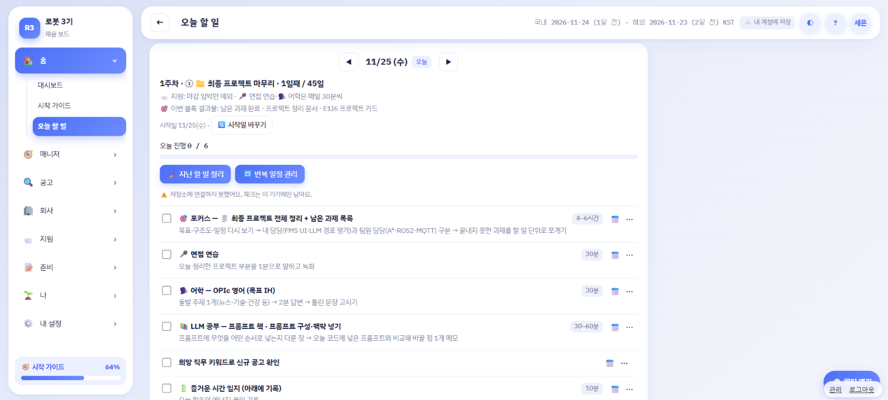

# 03 / 09 · 오늘 할 일

**메뉴:** 홈 › 오늘 할 일

하루 단위의 준비 과제를 보고 완료 여부를 기록합니다.

- 날짜를 바꾸어 이전·다음 할 일을 볼 수 있습니다.
- 반복 일정과 제안된 할 일을 관리할 수 있습니다.

[← 이전 화면](02-start-guide.md) · [다음 화면 →](04-self.md)

> 공고 수, 날짜와 진행률은 촬영 시점의 예시입니다.
