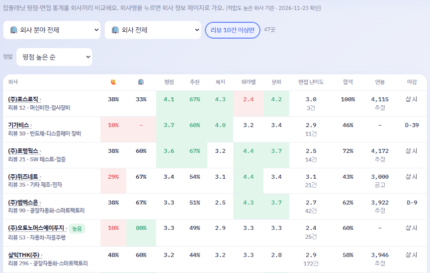

# 04 / 08 · 회사를 함께 비교하기

**메뉴:** 회사 › 회사 비교

> 회사별 평점, 추천율, 복지, 문화, 면접 난이도와 마감 정보를 비교합니다.

| 관점 | 설명 |
|---|---|
| 왜 필요한가 | 직무가 같아도 회사 문화·복지·면접 경험이 달라 지원 우선순위가 달라집니다. |
| 어떻게 쓰나 | 회사별 평점, 추천율, 복지, 문화, 면접 난이도와 마감 정보를 비교합니다. |
| 남는 것 | 지원 순서를 정하고 더 확인할 회사를 고릅니다. |

[← 이전 화면](03-jobs.md) · [다음 화면 →](05-posting-prep.md)

> 화면 속 공고 수·날짜·진행률은 촬영 시점의 예시입니다.
