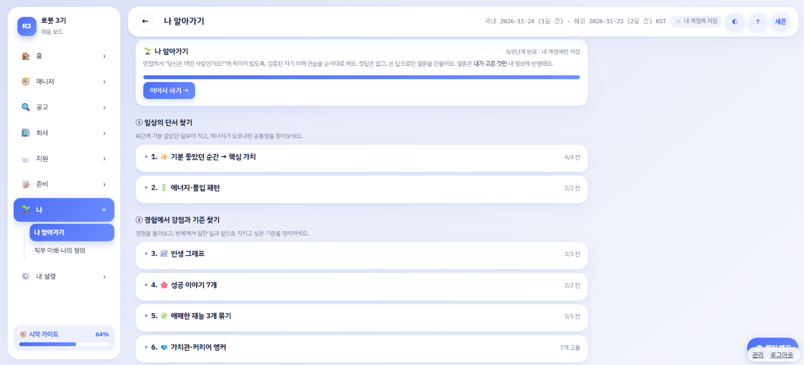

# 04 / 09 · 나 알아가기

**메뉴:** 나 › 나 알아가기

경험과 선호를 짧은 질문에 기록하고 자신에게 맞는 직무를 탐색합니다.

- 기분 좋았던 순간, 에너지 패턴, 강점과 가치관을 단계별로 정리합니다.
- 기록은 내 정보와 상담에 활용할 수 있습니다.

[← 이전 화면](03-today.md) · [다음 화면 →](05-role-study.md)

> 공고 수, 날짜와 진행률은 촬영 시점의 예시입니다.
