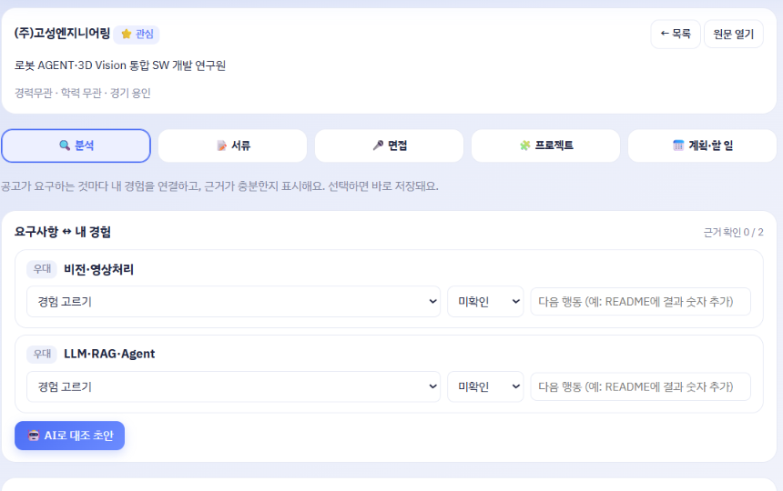

# 05 / 08 · 요건을 내 경험에 연결

**메뉴:** 매니저 › 공고별 준비

> 요건마다 경험과 근거 상태를 기록하고 다음 행동을 적습니다.

| 관점 | 설명 |
|---|---|
| 왜 필요한가 | 공고의 필수·우대 조건을 읽어도 무엇을 근거로 보여줄지 막막할 수 있습니다. |
| 어떻게 쓰나 | 요건마다 경험과 근거 상태를 기록하고 다음 행동을 적습니다. |
| 남는 것 | 서류·면접·프로젝트 준비로 이어지는 공고별 계획이 남습니다. |

[← 이전 화면](04-compare.md) · [다음 화면 →](06-documents.md)

> 화면 속 공고 수·날짜·진행률은 촬영 시점의 예시입니다.
