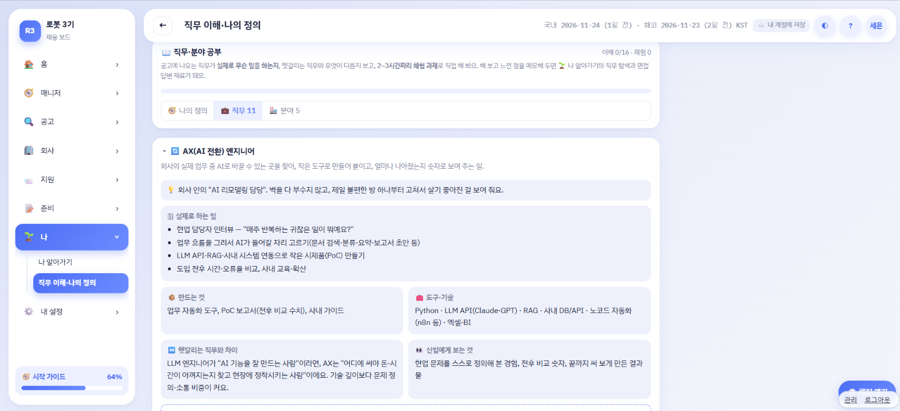

# 05 / 09 · 직무 이해

**메뉴:** 나 › 직무 이해·나의 정의

관심 직무가 실제로 하는 일과 필요한 도구·기술을 살펴봅니다.

- 직무와 분야별 설명을 확인합니다.
- 관찰하거나 직접 해 본 내용을 메모해 직무 선택의 근거로 씁니다.

[← 이전 화면](04-self.md) · [다음 화면 →](06-documents.md)

> 공고 수, 날짜와 진행률은 촬영 시점의 예시입니다.
