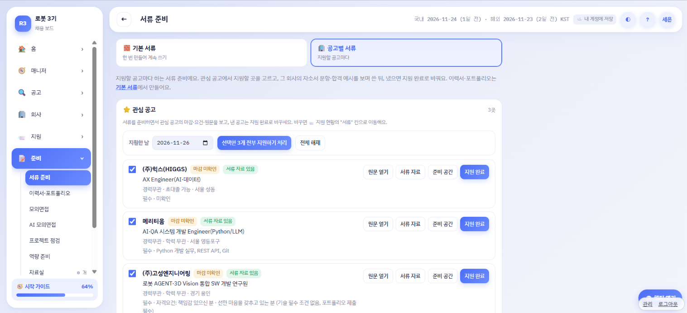

# 06 / 09 · 서류 준비

**메뉴:** 준비 › 서류 준비

관심 공고의 조건을 확인하고 공고마다 준비 상태를 기록합니다.

- 원문, 준비 공간과 서류 자료를 공고 단위로 엽니다.
- 실제 지원은 채용 사이트에서 하며, 보드에는 지원 상태를 기록합니다.

[← 이전 화면](05-role-study.md) · [다음 화면 →](07-posting-prep.md)

> 공고 수, 날짜와 진행률은 촬영 시점의 예시입니다.
