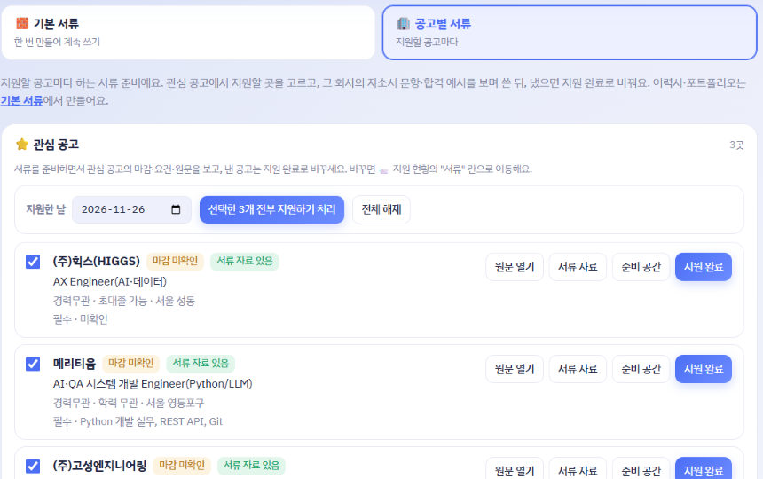

# 06 / 08 · 지원할 서류 준비

**메뉴:** 준비 › 서류 준비 · 지원서 입력

> 관심 공고의 마감과 조건을 보고 서류 자료, 지원서 입력 정보, 준비 공간을 엽니다.

| 관점 | 설명 |
|---|---|
| 왜 필요한가 | 같은 프로필을 반복 입력하고 공고별 수정 지점을 놓치기 쉽습니다. |
| 어떻게 쓰나 | 관심 공고의 마감과 조건을 보고 서류 자료, 지원서 입력 정보, 준비 공간을 엽니다. |
| 남는 것 | 어느 공고에 무엇을 제출할지 정리합니다. |

[← 이전 화면](05-posting-prep.md) · [다음 화면 →](07-mock-interview.md)

> 화면 속 공고 수·날짜·진행률은 촬영 시점의 예시입니다.
