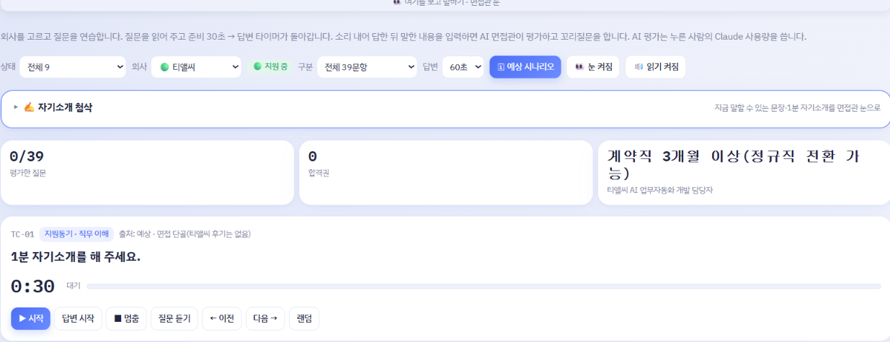

# 07 / 08 · 답변을 실제로 연습

**메뉴:** 준비 › 모의면접

> 회사를 고르고 질문 듣기·답변 타이머·음성 입력·기록을 사용합니다.

| 관점 | 설명 |
|---|---|
| 왜 필요한가 | 예상 질문을 알아도 실제 면접에서는 말의 순서와 시간이 흔들릴 수 있습니다. |
| 어떻게 쓰나 | 회사를 고르고 질문 듣기·답변 타이머·음성 입력·기록을 사용합니다. |
| 남는 것 | 답변 기록과 다시 연습할 질문을 확인합니다. |

[← 이전 화면](06-documents.md) · [다음 화면 →](08-today.md)

> 화면 속 공고 수·날짜·진행률은 촬영 시점의 예시입니다.
