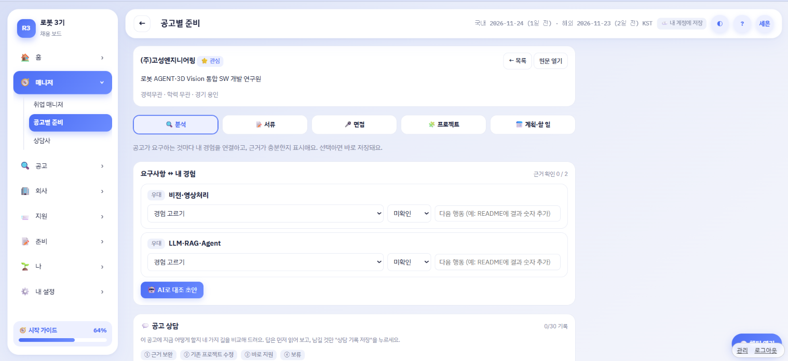

# 07 / 09 · 공고별 준비

**메뉴:** 매니저 › 공고별 준비

공고 요구사항과 내 경험을 비교해 지원에 필요한 근거를 정리합니다.

- 분석·서류·면접·프로젝트·계획/할 일 탭으로 이어집니다.
- 필수·우대 요건마다 경험과 다음 행동을 기록합니다.

[← 이전 화면](06-documents.md) · [다음 화면 →](08-mock-interview.md)

> 공고 수, 날짜와 진행률은 촬영 시점의 예시입니다.
