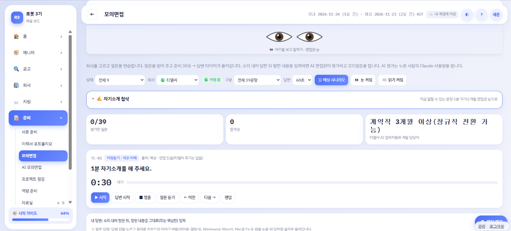

# 08 / 09 · 모의면접

**메뉴:** 준비 › 모의면접

회사와 질문을 골라 답변 시간을 재며 면접을 연습합니다.

- 질문 듣기, 답변 시작·정지, 이전·다음 질문 이동이 가능합니다.
- 말하거나 입력한 답변을 점검하고 기록합니다.

[← 이전 화면](07-posting-prep.md) · [다음 화면 →](09-interview-questions.md)

> 공고 수, 날짜와 진행률은 촬영 시점의 예시입니다.
