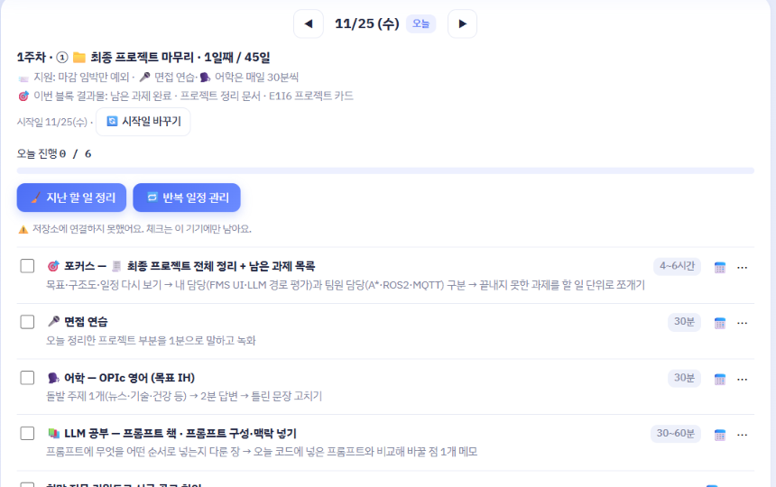

# 08 / 08 · 다음 행동을 놓치지 않기

**메뉴:** 홈 › 오늘 할 일

> 오늘 할 일을 체크하고 반복 일정과 제안된 작업을 관리합니다.

| 관점 | 설명 |
|---|---|
| 왜 필요한가 | 마감과 준비 과제가 쌓이면 우선순위가 흐려집니다. |
| 어떻게 쓰나 | 오늘 할 일을 체크하고 반복 일정과 제안된 작업을 관리합니다. |
| 남는 것 | 실행 기록이 남고 다음 날의 작업으로 이어집니다. |

[← 이전 화면](07-mock-interview.md) · [PC용 슬라이드 보기 →](../product-tour.html)

> 화면 속 공고 수·날짜·진행률은 촬영 시점의 예시입니다.
