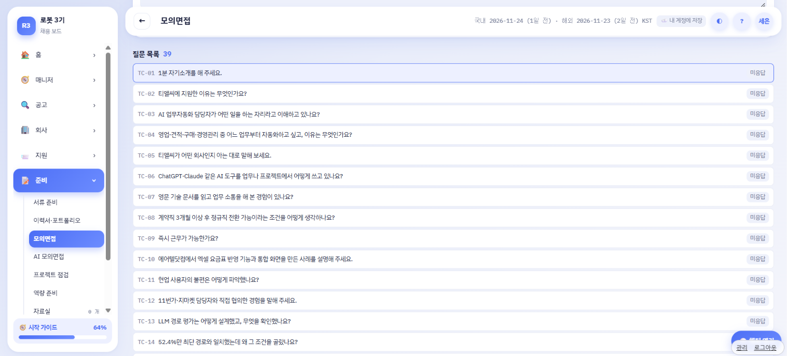

# 09 / 09 · 면접 질문 목록

**메뉴:** 준비 › 모의면접 › 질문 목록

질문을 목록으로 훑고 답변 여부를 확인합니다.

- 질문을 눌러 해당 문항으로 이동합니다.
- AI 모의면접 메뉴에서는 전형 전체를 별도로 연습합니다.

[← 이전 화면](08-mock-interview.md) · [README로 →](../../README.md)

> 공고 수, 날짜와 진행률은 촬영 시점의 예시입니다.
